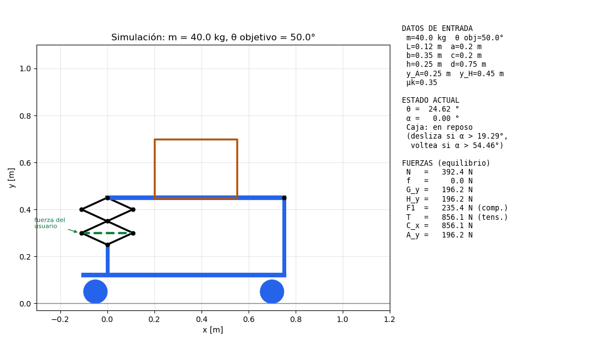
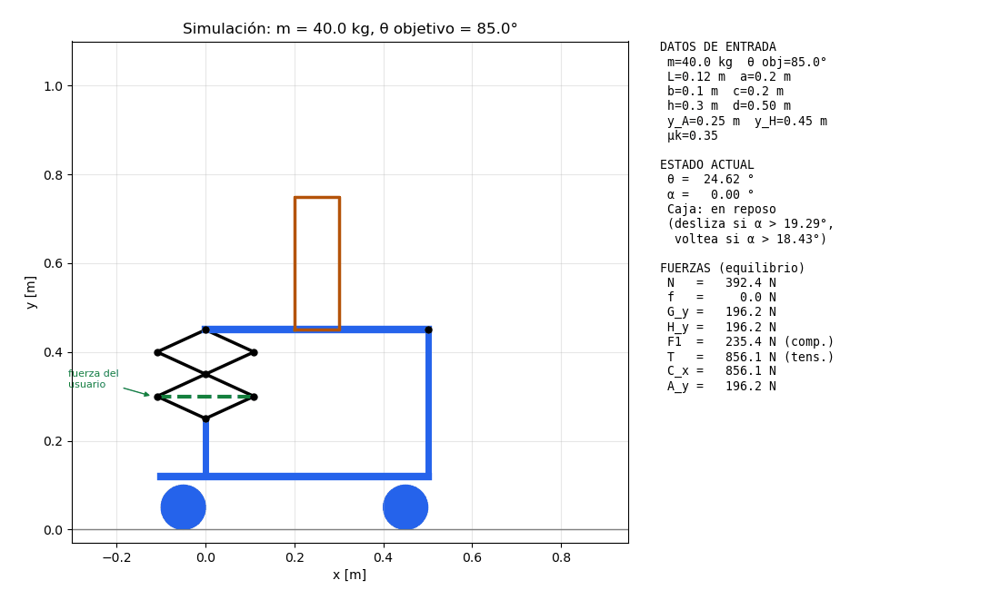
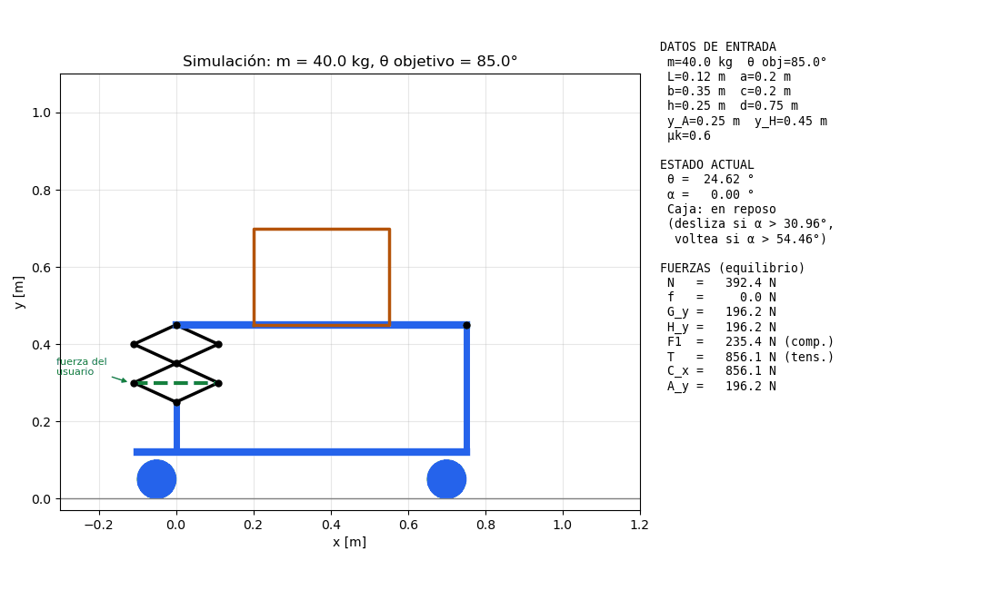
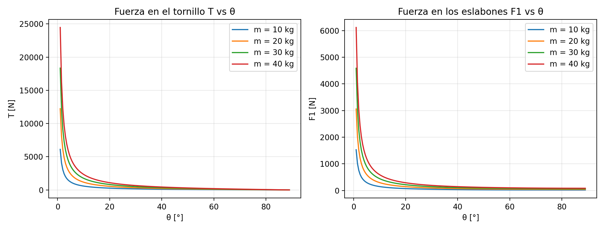

# Mesa con mecanismo de tijera: fuerzas y simulación

Programa en Python que calcula las fuerzas de una mesa elevadora de tijera (Modelo 1) con una caja encima y **simula en un GIF** qué pasa cuando la tijera sube hasta un ángulo θ. Si la mesa se inclina demasiado, la caja se desliza o se voltea y se cae.


## Índice

1. [Qué hace](#qué-hace)
2. [Estructura del repo](#estructura-del-repo)
3. [Requisitos e instalación](#requisitos-e-instalación)
4. [Cómo correrlo](#cómo-correrlo)
5. [Datos de entrada](#datos-de-entrada)
6. [Casos de ejemplo](#casos-de-ejemplo)
7. [Cómo probar tus propios casos](#cómo-probar-tus-propios-casos)
8. [Qué calcula (modelo)](#qué-calcula-modelo)
9. [Archivos que genera](#archivos-que-genera)
10. [Problemas comunes](#problemas-comunes)

## Qué hace

- Pide los datos de entrada (o los toma de los argumentos) y calcula todas las fuerzas por equilibrio estático.
- Imprime en consola las fuerzas y a partir de qué θ la caja se desliza o se voltea.
- Genera un GIF donde la tijera sube desde la mesa horizontal hasta el θ que pusiste, con α, el estado de la caja y las fuerzas en vivo.
- Si la caja se desliza o se voltea, se sale de la mesa y cae. Mientras se mueve, el panel avisa que ya no hay equilibrio estático.
- Guarda una tabla de barrido (`barrido_tijera.csv`) y una gráfica de la fuerza en los eslabones (`graficas_tijera.png`).

## Estructura del repo

```
tijera-fuerzas-/
├── tijera_fuerzas.py       # el programa
├── requirements.txt        # dependencias (matplotlib, pillow)
├── ejecutar.bat            # lanzador de doble clic para Windows
├── ejecutar.command        # lanzador de doble clic para macOS / Linux
├── README.md
├── simulacion_tijera.gif   # GIF del último run (se sobrescribe)
├── graficas_tijera.png     # gráfica F1 vs θ (se sobrescribe)
├── barrido_tijera.csv      # tabla de barrido (se sobrescribe)
├── codigo/                 # copia del código completo para copiar y pegar
│   └── tijera_fuerzas.py
└── ejemplos/               # GIFs y salidas de consola de casos de ejemplo
```

## Requisitos e instalación

Necesitas **Python 3.9 o superior** y dos librerías: `matplotlib` (dibuja y anima) y `pillow` (guarda el GIF). Funciona en Windows, macOS y Linux.

> **Atajo:** si no quieres instalar nada a mano, salta a [Opción C: doble clic](#opción-c-doble-clic-instala-y-corre-solo). Los lanzadores crean el entorno e instalan las librerías por ti.

### 1. Instala Python

| Sistema | Cómo |
|---|---|
| **Windows** | Descarga el instalador de <https://www.python.org/downloads/>, ábrelo y **marca la casilla "Add Python to PATH"** antes de darle Install. También puedes instalarlo desde la Microsoft Store (busca "Python 3.12" o más reciente). |
| **macOS** | Descarga el instalador de <https://www.python.org/downloads/> o usa Homebrew: `brew install python`. |
| **Linux (Debian/Ubuntu)** | `sudo apt install python3 python3-venv python3-pip` |

Verifica que quedó:

| Sistema | Comando |
|---|---|
| Windows (PowerShell o CMD) | `python --version` (si no responde, prueba `py --version`) |
| macOS / Linux | `python3 --version` |

Debe decir 3.9 o mayor.

### 2. Descarga el repo

Con git:

```bash
git clone https://github.com/m2galindo/tijera-fuerzas-.git
cd tijera-fuerzas-
```

Sin git: en GitHub dale a **Code → Download ZIP**, descomprime y abre la carpeta.
En Windows puedes abrir una terminal dentro de la carpeta con clic derecho → "Abrir en Terminal" (o escribe `cmd` en la barra de direcciones del Explorador).

### 3. Instala las dependencias

**Forma más fácil: una sola bandera.** El programa se instala sus propias dependencias (`matplotlib` y `pillow`) con el mismo Python que lo corre:

```bash
python tijera_fuerzas.py --instalar          # Windows
python3 tijera_fuerzas.py --instalar         # macOS / Linux
```

Instala y termina. Si además le pasas datos (`--instalar --theta 85`) o `-i`, después de instalar corre normal. Si usas entorno virtual, actívalo antes para que se instale ahí.

**Forma manual.**

Se recomienda un entorno virtual para no mezclar librerías con las de tu sistema.

**Windows (PowerShell):**

```powershell
python -m venv .venv
.venv\Scripts\Activate.ps1
pip install -r requirements.txt
```

**Windows (CMD):**

```bat
python -m venv .venv
.venv\Scripts\activate.bat
pip install -r requirements.txt
```

**macOS / Linux:**

```bash
python3 -m venv .venv
source .venv/bin/activate
pip install -r requirements.txt
```

El entorno se crea una sola vez. En cada terminal nueva solo repite la línea de activación (la segunda).

Sin entorno virtual también funciona:

```bash
pip install matplotlib pillow          # Windows: python -m pip install matplotlib pillow
```

### 4. Verifica la instalación

```bash
python -c "import matplotlib, PIL; print('OK')"      # Windows
python3 -c "import matplotlib, PIL; print('OK')"     # macOS / Linux
```

Debe imprimir `OK`. Si marca `ModuleNotFoundError`, repite el paso 3 con el entorno activado.

## Cómo correrlo

Hay tres formas. En todas, el programa genera el GIF, la gráfica y el CSV en la carpeta del repo.

> En los comandos de abajo usa `python` en Windows y `python3` en macOS / Linux. Con el entorno virtual activado, `python` funciona en todos.

### Opción A: te pide los datos (interactivo)

```bash
python tijera_fuerzas.py
```

Te pregunta uno por uno m, θ, L, a, b, c, h, y_A, y_H y μk, con el valor por defecto entre corchetes:

```
Masa de la caja (máx. 40 kg) [40.0 kg]: 20,5
Ángulo de la tijera θ [50.0 °]:
```

- **Enter** = usa el valor por defecto.
- Escribe un número para cambiarlo (acepta coma o punto decimal).
- Si escribes algo que no es número, te lo vuelve a pedir.

**Mezclar las dos formas:** con `-i` (o `--interactivo`) te pregunta todo, pero los argumentos que pases quedan como valor por defecto de esa pregunta:

```bash
python tijera_fuerzas.py -i --theta 85
```

Aquí te pregunta todos los datos y en θ el valor que aparece es 85.

### Opción B: directo, con argumentos (no pregunta nada)

```bash
python tijera_fuerzas.py --m 40 --theta 85
python tijera_fuerzas.py --m 20 --theta 60 --mu_k 0.5
```

Los datos que no pongas usan su valor por defecto. Es lo más cómodo para repetir un caso.

### Opción C: doble clic (instala y corre solo)

El repo trae dos lanzadores. La primera vez crean el entorno virtual e instalan las librerías; después solo corren el programa y te piden los datos.

| Sistema | Qué hacer |
|---|---|
| **Windows** | Doble clic en `ejecutar.bat`. Si prefieres terminal: `.\ejecutar.bat` |
| **macOS** | Doble clic en `ejecutar.command`. Si macOS dice que no se puede abrir, clic derecho → Abrir. Desde terminal: `./ejecutar.command` |
| **Linux** | `./ejecutar.command` |

También aceptan argumentos, por ejemplo `.\ejecutar.bat --theta 85` o `./ejecutar.command -i --theta 85`.

### Qué pasa al correr

1. Imprime los datos de entrada y las fuerzas con la mesa horizontal y con tu ángulo.
2. Imprime a partir de qué θ la caja se desliza o se voltea y el veredicto.
3. Guarda el CSV y la gráfica.
4. Genera `simulacion_tijera.gif` (tarda unos segundos).

> **Importante:** cada corrida **sobrescribe** `simulacion_tijera.gif`, `graficas_tijera.png` y `barrido_tijera.csv`. Si quieres conservar uno, cámbiale el nombre o muévelo antes de volver a correr:
> ```bash
> mv simulacion_tijera.gif ejemplos/mi_caso.gif        # macOS / Linux
> move simulacion_tijera.gif ejemplos\mi_caso.gif      # Windows
> ```

> Si corres sin pantalla (servidor, SSH) usa `MPLBACKEND=Agg python3 tijera_fuerzas.py --theta 85`. En Windows: `set MPLBACKEND=Agg` y luego el comando.

### Ver el GIF

Ábrelo con el navegador (arrástralo a una pestaña) o con el visor de imágenes. En Windows el visor de fotos no anima GIFs; usa el navegador.

## Datos de entrada

Otras banderas: `--instalar` (instala las dependencias) e `-i` / `--interactivo` (pregunta todo).

| Argumento | Descripción | Por defecto |
|---|---|---|
| `--m` | Masa de la caja (máx. 40 kg) | 40 kg |
| `--theta` | Ángulo de los brazos de la tijera con la horizontal, θ (0° a 90°) | 50° |
| `--L` | Largo de cada eslabón corto de la tijera | 0.12 m |
| `--a` | Distancia del apoyo G al borde de la caja | 0.20 m |
| `--b` | Base de la caja (≤ 0.40 m) | 0.35 m |
| `--c` | Distancia del borde de la caja al poste H | 0.20 m |
| `--h` | Altura de la caja (≤ 0.30 m) | 0.25 m |
| `--y_A` | Altura del perno A (base de la tijera) | 0.25 m |
| `--y_H` | Altura del perno H (poste fijo) | 0.45 m |
| `--mu_k` | Coeficiente de fricción cinética caja-mesa | 0.35 |

La longitud total de la mesa se calcula sola: `d = a + b + c`. Unidades: longitudes en m, fuerzas en N, ángulos en grados.

## Casos de ejemplo

Con los datos por defecto, la mesa queda horizontal con θ = 24.62°. La caja **se desliza** con α > 19.29° (θ > 68.88°) y **se voltearía** con α > 54.46°, ángulo al que la tijera no llega.

### Caso 1: θ = 50°, la caja se queda en su lugar

```bash
python3 tijera_fuerzas.py --theta 50
```



Salida completa: [`ejemplos/salida_theta50.txt`](ejemplos/salida_theta50.txt).

### Caso 2: θ = 85°, la caja se desliza y se cae

```bash
python3 tijera_fuerzas.py --theta 85
```


| α | N | f | G_y | H_y | F1 | T |
|---|---|---|---|---|---|---|
| 21.77° | 364.4 N | 145.5 N | 170.1 N | 222.3 N | 85.4 N | 29.8 N |

Como α = 21.77° > 19.29°, la caja se desliza hasta salirse de la mesa. Salida completa: [`ejemplos/salida_theta85.txt`](ejemplos/salida_theta85.txt).

### Caso 3: caja alta y angosta, se voltea

```bash
python3 tijera_fuerzas.py --theta 85 --b 0.1 --h 0.3
```



Aquí `b/h = 0.33 < μk = 0.35`, así que la caja se voltea sobre su esquina antes de deslizarse. Salida completa: [`ejemplos/salida_volteo.txt`](ejemplos/salida_volteo.txt).

### Caso 4: más fricción, la caja ya no se desliza

```bash
python3 tijera_fuerzas.py --theta 85 --mu_k 0.6
```



Con μk = 0.6 el límite de deslizamiento sube a α > 30.96°. El mismo θ = 85° que en el caso 2 ahora da α = 21.77° y la caja se queda en su lugar.

### Caso 5: menos masa y ángulo medio

```bash
python3 tijera_fuerzas.py --m 20 --theta 60
```

Resultado en consola: α = 16.71°, N = 187.9 N, f = 56.4 N, F1 = 51.0 N. Como α < 19.29° la caja se queda en su lugar.

### Caso 6: ángulo imposible

```bash
python3 tijera_fuerzas.py --theta 120
```

```
ERROR: con θ = 120.0° la tijera no puede armar la mesa con estas medidas.
Prueba otro ángulo (0° < θ < 90°) o revisa L, y_A, y_H y d.
```

El programa avisa y termina sin generar archivos.

## Cómo probar tus propios casos

0. Si prefieres que te pregunte, corre `python tijera_fuerzas.py` sin argumentos.
1. Elige qué quieres cambiar: masa, ángulo, medidas de la caja o fricción.
2. Corre el programa con los argumentos correspondientes, por ejemplo:
   ```bash
   python3 tijera_fuerzas.py --m 30 --theta 70 --b 0.25 --h 0.30 --mu_k 0.4
   ```
3. Lee en consola la última línea que empieza con `>>`: te dice si la caja se queda, se desliza o se voltea.
4. Abre `simulacion_tijera.gif` para ver el movimiento (arrástralo a un navegador o ábrelo con tu visor de imágenes).
5. Guarda el GIF con otro nombre si quieres conservarlo.

Reglas para elegir datos:
- Para ver **deslizamiento**: sube θ por encima de la θ crítica que imprime el programa, o baja μk.
- Para ver **volteo**: usa una caja alta y angosta con `b/h < μk` (por ejemplo `--b 0.1 --h 0.3`).
- Para que la caja **se quede**: baja θ o sube μk.
- Si el programa dice que θ no es posible, prueba otro ángulo o revisa L, y_A, y_H y d (el ángulo máximo depende de la geometría).

## Qué calcula (modelo)

Con la masa m y el ángulo θ obtiene, por equilibrio estático:

| Variable | Qué es |
|---|---|
| α | Inclinación de la mesa: `sin α = (y_A + 4·L·sin θ − y_H) / d` |
| N, f | Fuerza normal y fuerza de fricción sobre la caja |
| G_y, H_y | Reacciones en los apoyos de la mesa (ΣM_H = 0 y ΣF_y = 0) |
| F1 | Compresión en los eslabones de la tijera: `G_y / (2 sin θ)` |
| T (= C_x) | Tensión en el tornillo B–D: `2·G_y / tan θ` |
| A_y | Reacción vertical en el perno A |

Criterios para la caja:
- **Se desliza** si `tan α > μk`.
- **Se voltea** si `tan α > b/h`.
- Si `b/h < μk`, se voltea antes de deslizarse.

La fuerza que aplica el usuario en la manivela produce T y fija θ. Su valor depende de la rosca y no se calcula aquí. T se imprime en consola y se guarda en el CSV, pero ya no se grafica.

## Archivos que genera

| Archivo | Contenido |
|---|---|
| `simulacion_tijera.gif` | Animación: la tijera sube y la caja se queda, se desliza, se voltea o cae. Panel con datos de entrada, θ, α, estado y fuerzas |
| `graficas_tijera.png` | Fuerza en los eslabones F1 contra θ para m = 10, 20, 30 y 40 kg |
| `barrido_tijera.csv` | Todas las fuerzas para m = 10, 20, 30, 40 kg y θ = 5° a 85° cada 5° |



## Problemas comunes

| Problema | Solución |
|---|---|
| `python3: command not found` (Windows) | Usa `python` en lugar de `python3`, o `py` |
| `'python' is not recognized` (Windows) | Reinstala Python marcando "Add Python to PATH", o usa `py` |
| PowerShell dice que la ejecución de scripts está deshabilitada al activar el entorno | Usa CMD (`.venv\Scripts\activate.bat`) o corre `Set-ExecutionPolicy -Scope CurrentUser RemoteSigned` |
| Los símbolos θ, α, μ salen raros en Windows | Ya se fuerza UTF-8 en el programa; si sigue, usa Windows Terminal o `chcp 65001` |
| macOS no deja abrir `ejecutar.command` | Clic derecho → Abrir, o `chmod +x ejecutar.command` |
| `ModuleNotFoundError: No module named 'matplotlib'` | Corre `python tijera_fuerzas.py --instalar` (con el entorno virtual activado si usas uno) o `pip install -r requirements.txt` |
| `pip: command not found` | Usa `python3 -m pip install -r requirements.txt` |
| `error: externally-managed-environment` | Usa un entorno virtual (paso 3 de la instalación) |
| `ERROR: ... la tijera no puede armar la mesa` | Elige otro θ entre 0° y 90° o revisa L, y_A, y_H y d |
| El GIF no cambió | Se sobrescribe en cada corrida; revisa que corriste en la carpeta correcta |
| Decimales con coma en argumentos | En argumentos usa punto (`--mu_k 0.4`); en modo interactivo se acepta coma |
